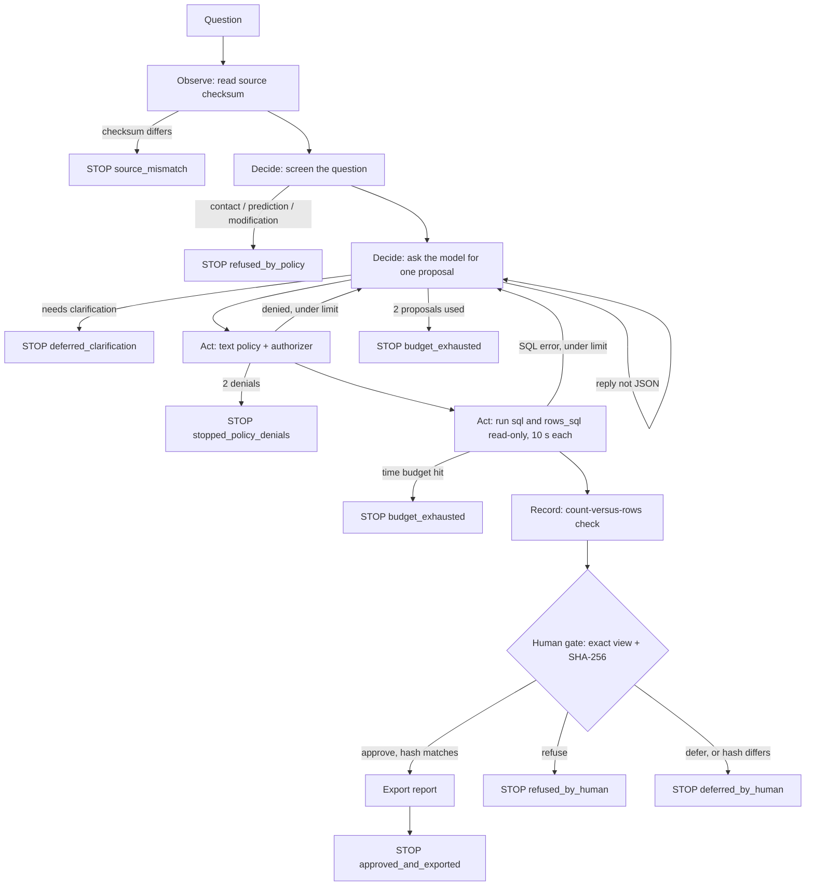

# Plan

Packet document 4 of 10. Previous: [action-surface-map.md](action-surface-map.md) · Next: [gates.md](gates.md)

The steps for one question, their dependencies, the evidence on each edge, and the stop and refusal paths. Code: [sponsorsql/agent.py](sponsorsql/agent.py).

## Steps, dependencies and evidence

| # | Step | Depends on | Evidence that it works |
|---|---|---|---|
| 0 | Load the workbook: verify the checksum, keep 18 fields, drop 595,239 blank rows | The public file, downloaded by hand | `evidence/load.log`: 437,496 rows, 70 s. The development key rebuilt byte-for-byte from this load (SHA-256 `db93d4dc…`). |
| 1 | Observe: read the source checksum on a system-only connection | Step 0 | Test `test_wrong_source_database_stops_before_anything_runs` |
| 2 | Decide: screen the question | — | Tests `test_screened_questions_never_reach_the_model`; failure cases F5, F6 (model called 0 times) |
| 3 | Decide: build the prompt (contract + schema + question) and get one proposal | Step 2; the contract file | `evals/proposals/*-prompts.json` holds the exact text; recorded replies in `evals/proposals/*-responses.json` |
| 4 | Act: text policy, then the authorizer at execution | Step 3 | Tests 1–3; failure cases F1–F3 |
| 5 | Act: run the answer query and the evidence query under the time budget | Step 4 | Test 4; failure case F4 (all 437,496 rows still present afterwards) |
| 6 | Record: count-versus-rows check, state file, ledger line | Step 5 | Tests 9, 11; failure case F10 |
| 7 | Gate: a person sees the view and approves, refuses or defers | Step 6 | Test 8; failure case F9; [gates.md](gates.md) |
| 8 | Export: write the report only on a matching approval | Step 7 | `gate.export_report` raises `PermissionError` otherwise (test `test_export_refuses_without_matching_approval`) |

## Evaluation plan

Frozen before any proposal: [evals/FREEZE.md](evals/FREEZE.md).
1. Development round 1 with contract v1.
2. Read the failures and revise the contract (v2) only from development results.
3. Development round 2 with v2.
4. Held-out, once, with the final contract.
5. Deliberate failure cases and the controlled failure: `python3 -m sponsorsql failures`.

The results are in [evidence.md](evidence.md).

## Stop and refusal paths

The loop has nine stop reasons (`sponsorsql/state.py`). None comes from the model saying it's finished. Refusal happens before the model is called (screen), or after it (policy denial). Deferral happens on a clarification request, a human defer, or an approval bound to a different view.
