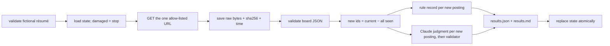

# Job-Search Agent 1 — The Contract and the Watch

INFO 7375 · Fall 2026 · Suketh Produtoor (`suketh-p`) · branch `js1-contract-and-watch`

`jobwatch` watches one public job board (Anthropic's Greenhouse board). It remembers every posting id it has seen and reports only postings that are new since the last run. Each new posting gets two verdicts. One is a **record**: a four-condition rule anyone can recompute from [CONTRACT.md](CONTRACT.md). The other is a **model judgment** from Claude under a fixed prompt contract, and a validator rejects any reply that doesn't cite real résumé and posting fields. The résumé belongs to a fictional persona, Alex Morgan (`persona/alex_morgan.json`).

[CONTRACT.md](CONTRACT.md) is the specification. It was committed before any code existed (commit `29b3a26`).

Claude Code drafted this README from the commit record. The student's own words are quoted and attributed, and [SOURCES.md](SOURCES.md) says who wrote what.

## Language, toolchain, and what a TA needs

| | |
|---|---|
| Language | Python 3, standard library only (no `pip install`). Ran on Python 3.12.7, macOS 27.0.1. |
| Tests | `unittest` (standard library), 93 tests, offline. Claude Code wrote 92 of them. The student wrote `tests/test_my_cases.py`, a regression test on three saved real postings, after the code. The student's own Terminal run at `9243e75` covered the first 91. |
| Prompt | Future runs use `prompts/judge_v2.md` (the student's decision, 2026-10-31). Runs 1 and 2, the sampling, and the demo used `judge_v1`; each results file records the prompt it used. |
| Claude, for new postings only | Default `--judge claude-code`: the `claude` CLI (Claude Code 2.1.291), logged in. Alternative `--judge api`: `ANTHROPIC_API_KEY` set in the shell. The `api` route was only tested against fakes; it never made a real call (no key was available). |
| Model | `claude-opus-5-5` |
| Network | Exactly two allow-listed requests: `GET https://boards-api.greenhouse.io/v1/boards/anthropic/jobs?content=true` and `POST https://api.anthropic.com/v1/messages` (api route only) |

Run every command from this folder (`fall-2026/suketh-p/js1-contract-and-watch/`).

**1. Run the tests (offline, about a second):**

```bash
python3 -m unittest -v
```

**2. Check that the saved raw responses are byte-for-byte what Greenhouse sent.** Each run stores its raw body gzipped (about 10 MB unzipped); this command recomputes the sha256 recorded at retrieval time:

```bash
python3 -m jobwatch verify runs/20261028T102612Z-live
```

```bash
python3 -m jobwatch verify runs/20261031T125015Z-live
```

**3. Recompute the rule record for any posting by hand or by command** (here, the one posting that run 2 found relevant):

```bash
python3 -m jobwatch rule --resume persona/alex_morgan.json --raw runs/20261031T125015Z-live/raw_response.json.gz --id 5464234008
```

**4. Replay the two runs offline into a scratch state file (SEEDED, no network).** The first command is a baseline and needs no Claude. The second finds the 27 new postings, so it needs a logged-in `claude` CLI (or add `--judge api` with a key):

```bash
python3 -m jobwatch run --from-file runs/20261028T102612Z-live/raw_response.json.gz --resume persona/alex_morgan.json --state /tmp/js1-ta/state.json --out /tmp/js1-ta/runs
```

```bash
python3 -m jobwatch run --from-file runs/20261031T125015Z-live/raw_response.json.gz --resume persona/alex_morgan.json --state /tmp/js1-ta/state.json --out /tmp/js1-ta/runs
```

**5. A live run of your own.** Use a fresh state path. The committed `state/state.json` is this project's evidence; don't advance it.

```bash
python3 -m jobwatch run --resume persona/alex_morgan.json --state /tmp/js1-live/state.json --out /tmp/js1-live/runs
```

## What ran

All times EDT. "Code" is the commit the run used.

| When | What | Mode | Result | Evidence | Code |
|---|---|---|---|---|---|
| 2026-10-28 06:26 | **Run 1**, baseline | live | 681 postings recorded as seen; 0 reported as new; no Claude calls | [runs/20261028T102612Z-live](runs/20261028T102612Z-live/results.md), [terminal](evidence/terminal/2026-10-28-run1-live-baseline.txt) | `546fd7a` |
| 2026-10-31 08:49 | Agent judges posting 5418610008 (action surface 3) | **SEEDED** | a constructed baseline (run 1 minus 5418610008), then a replay of run 1: 1 new; rule relevant, Claude relevant | [action-surface/3-agent](action-surface/3-agent/terminal-2026-10-31.txt) | `7752e69` |
| 2026-10-31 08:50 | **Run 2**, three calendar days later | live | 675 postings, 27 new. Each new posting got a rule record and a Claude judgment. All 27 replies passed the validator. The two judges agreed on 27/27. 1 relevant (5464234008, Data Engineer). Claude Code reported $1.04 for the 27 calls. | [runs/20261031T125015Z-live](runs/20261031T125015Z-live/results.md), [terminal](evidence/terminal/2026-10-31-run2-live.txt) | `7752e69` |
| 2026-10-31 08:53 | Claude reads files itself (action surface 2) | real `claude -p`, Read tool only | 3 Read calls; relevant; the validator accepted the answer | [action-surface/2-file-read](action-surface/2-file-read/summary.json) | `a516410` |
| 2026-10-31 morning | Paste into a chat (action surface 1), done by the student | claude.ai, Opus 5.5, effort Max (as shown in the chat) | `relevant`; the agent's validator accepted the copied reply | [action-surface/1-chat](action-surface/1-chat/README.md) | n/a |
| 2026-10-31 09:05 | The 20 labels the student's own script computed vs the rule records | consistency check, **not hand labels** (see "The labels were computed by a script" below) | identical on 20/20; the student's reasons name the same failed conditions in 14/14 negatives | [experiments/hand-vs-rule.md](experiments/hand-vs-rule.md) | `0f312fb` |
| 2026-10-31 09:08 | Sampling: 5 postings × 4 fresh conversations, prompt v1 | real `claude -p` | 20/20 valid; 20/20 equal the student's label; every posting unanimous | [reports/SAMPLING-REPORT.md](reports/SAMPLING-REPORT.md) | `0f3b4af` + one-line fix (`d2db430`) |
| 2026-10-31 09:06–09:18 | Prompt experiment: v1, then the student's one change (v2, justification names the field paths), on 10 development then 10 held-out postings, 3 calls each | real `claude -p` | Pass rate: v1 30/30 and 30/30; v2 30/30 and 29/30 (one malformed reply rejected). Justification names all 8 paths: v1 0/30 and 0/30; v2 30/30 and 29/29 | [reports/PROMPT-EXPERIMENT.md](reports/PROMPT-EXPERIMENT.md) | `0f3b4af`, `b0d2a88` |
| 2026-10-31 09:39 | Fresh clone from GitHub (sparse checkout of this folder) at `406fb0a` | real clone | 91 tests OK; both `verify` OK; `rule` recompute; offline baseline replay | [output](evidence/test-runs/2026-10-31-05-fresh-clone-from-github.txt) | `406fb0a` |
| 2026-10-31 09:46 | Fresh clone from GitHub (sparse checkout of this folder) at `4827519`, the signed v2 version | real clone | 92 tests OK; both `verify` OK; `rule` recompute; offline baseline replay | [output](evidence/test-runs/2026-10-31-06-fresh-clone-final.txt) | `4827519` |
| 2026-10-31 10:33 | Fresh clone from GitHub (sparse checkout of this folder) at `bed4432`, with the student's retrospective, test and conclusions | real clone | 93 tests OK, including the student's `tests/test_my_cases.py`; both `verify` OK; offline baseline replay | [output](evidence/test-runs/2026-10-31-07-fresh-clone-bed4432.txt) | `bed4432` |

The state file after each run is saved next to its results (`state_after.json`); the live state is [state/state.json](state/state.json), and git history shows it after run 1 (`78c1b1b`) and after run 2 (`a516410`).

## The labels were computed by a script, not by hand

The sampling report and the prompt experiment score Claude against 20 labels the student sent in chat on 2026-10-31. In the student's retrospective ([FRICTIONAL.md](FRICTIONAL.md)): "A read-only Python script applied the written rule to the twenty postings, and a separate script recomputed the results … They were not twenty independent judgments I made manually." The student wrote that script. It is not in this repo, and the student did not say whether it reused jobwatch's rule code.

What follows:
- **The brief's hand-labeling step was not done as written.** No posting was labeled by hand.
- **The 20/20 match with the rule records is a consistency check** between the student's script and the code. It is not independent verification of the rule code, or of whether these jobs suit anyone.
- **The pass rates measure agreement with script-computed labels** that equal the rule.
- **Timing:** the labels were committed (`0f312fb`, 09:05 EDT) before any sampling or prompt-experiment call, but after run 2 (27 calls), the seeded demo, the file-read surface, and the 2026-10-28 probes.
- **The rule's output had also been shown first.** Before the labels were sent, the conversation had already shown the rule's list of relevant postings (2026-10-28), `experiments/selection.json` recorded each posting's rule category, and both judges' verdicts on 5418610008 had been reported (2026-10-31).

The commit message of `0f312fb` says the labels were made "by reading labels/labeling-sheet.md", and file and field names such as `hand_labels.csv` call them hand labels. Both predate the student's disclosure. History and names were kept, and this section corrects them.

## How one run works



Any error before the last step leaves `state.json` untouched. The failed run's folder keeps the raw response and an `error.json`. A rejected Claude reply is an error, never a `not_relevant` verdict.

| Path | What it is |
|---|---|
| `jobwatch/net.py` | the only network code: allow-list of exactly two (method, URL) pairs, checked before every request; redirects refused |
| `jobwatch/resume.py`, `jobwatch/board.py` | input contracts for the persona and the board response |
| `jobwatch/normalize.py`, `jobwatch/rule.py` | the contract's normalization and four-condition rule, output as a record |
| `jobwatch/judge.py`, `prompts/judge_v1.md` | the prompt contract and the validator |
| `jobwatch/transports.py` | `claude -p` with tools, settings, MCP and saved sessions off; or one API POST |
| `jobwatch/run.py`, `jobwatch/state.py` | one run, and the state file |
| `tests/` | 93 tests, including the contract's wrong versions as code (`tests/wrong_versions.py`) and the student's own `tests/test_my_cases.py` |
| `experiments/`, `labels/` | sample selection, the student's labeling rule and labels, sampling and experiment scripts |
| `reports/` | sampling report, prompt experiment, action-surface comparison |

## Contract → code → test

| CONTRACT.md says | Code | Test that would fail if it broke |
|---|---|---|
| Validate the résumé structure and types first | `resume.validate_resume` | `test_inputs.ResumeValidationTest`; `test_run…test_invalid_resume_stops_before_any_request` |
| Board needs a jobs array; positive int id, nonempty title, string location.name, nonempty content | `board.parse_board` | `test_inputs.BoardValidationTest` |
| Identical duplicate ids → one result; conflicting → error | `board.parse_board` | `test_identical_duplicate_ids…`, `test_conflicting_records…` |
| Normalization and the four conditions | `normalize`, `rule` | `test_normalize`, `test_rule.RuleTableTest` (13 hand-worked cases) |
| Record shows each condition; negative names the failed ones | `rule.rule_verdict` | `test_rule.RuleRecordTest` |
| First run is a baseline with zero new | `run.run_once` | `test_run.WatchTest.test_first_run_is_a_baseline…` |
| New ids = current − all seen; edited title not new; returning id not new | `state.new_ids`, `run` | `WatchTest`, `NewIdsTest` |
| Raw saved unchanged, with time, before interpretation | `run._save_raw` | `test_raw_response_is_saved_unchanged…`, `test_raw_response_is_saved_before_it_is_interpreted` |
| Complete results, then atomic state; failures leave state; damaged state is an error | `run`, `state.save_state` | `FailureLeavesStateTest`, `test_failed_write_leaves_the_previous_state_intact` |
| Claude reply: one JSON object, exact keys, id, verdict, real paths, verbatim quotes | `judge.validate_response` | `test_validator.OutputFormatTest`, `UnsupportedJustificationTest` |
| A rejected reply is an error, never `not_relevant` | `judge.judge_posting`, `run` | `test_run.RejectedResponseTest` |
| Disagreement preserved; judgment labelled as one | `run.assess_one` | `OutputTest.test_disagreement…`, `test_each_verdict_is_labelled…` |
| Claude gets only the fixed instructions, persona, posting | `judge.build_request`, `posting_input` | `OutputTest.test_the_model_receives_only…` |
| Allow-listed hosts and paths, HTTPS, GET for the board, no redirects | `net` | `test_state_and_net.AllowListTest` |
| Credentials never printed | `transports.api_send` | `ApiTransportTest.test_errors_never_contain_the_key` |
| Wrong version 1: verdicts attached to the wrong posting | (`tests/wrong_versions.py`) | `test_wrong_versions_caught` swaps it in; `VerdictAttachmentTest` fails |
| Wrong version 2: unsupported justification accepted (W2a), or a rejection turned into `not_relevant` (W2b) | (`tests/wrong_versions.py`) | `test_wrong_versions_caught`; `UnsupportedJustificationTest`, `RejectedResponseTest` fail |

The tests were committed and seen failing before any implementation existed: `d945f28`, with output in [evidence/test-runs/](evidence/test-runs/).

## Calls Claude Code made where the contract was silent

On 2026-10-31 the student accepted four of these by name: "OK on the stricter fictional résumé checks, case-sensitive quotes after whitespace normalization, no retries, and lossless `.gz` storage with hash verification." The other three bullets (whitespace-only fields, what Claude sees, the API-route settings) were not reviewed one by one.

- **Résumé.** Exactly the persona's fields; `fictional` must be `true`; email must end `@example.com`; phone must be `NNN-555-NNNN`. Error messages name the field and never repeat its value.
- **"Nonempty"** title or content means not whitespace-only.
- **What Claude sees.** `{id, title, location.name, content}`, with the content as plain text (decoded, tags removed). No URLs or other metadata.
- **Quote check.** Exact and case-sensitive after collapsing whitespace. For a list field, the quote must come from one item. Résumé evidence must cite `resume.…` paths and posting evidence `posting.…` paths, and each must point at text.
- **No retries.** One rejected reply fails the whole run, and the next run asks again for every new posting.
- **Raw responses are stored as `.gz`.** The sha256 of the uncompressed bytes is recorded at retrieval, and `verify` rechecks it.
- **API route only.** Effort `medium` and `fallbacks: "default"`: a declined request may be answered by another Claude model, and the model that answered is recorded. No `temperature`, because the API has rejected it since 2026-10-21.

## Known limits

- **Claude Code adds context of its own.** On the `claude-code` route, each request carries roughly 800 tokens or more that this agent did not write and could not inspect. Asking what it was was declined by a safety classifier. See [evidence/probes/](evidence/probes/2026-10-28-claude-code-probes.md). The agent itself passes `claude -p` only the fixed prompt, the persona, and the posting.
- **The rule is literal.** "Data Center Controls Engineer" passes because "data" is a focus term. Some data-centre engineering roles pass every condition except Python.
- **No posting was labeled by hand.** The 20 reference labels were computed by the student's script applying the rule (see "The labels were computed by a script").
- **Only one board** (Anthropic), and only two live runs.

## Driver's seat

| Part of this task | Claude Code did | The student did | Why that part stays the student's | Where the split shows |
|---|---|---|---|---|
| What "relevant" means, and what the agent refuses | Converted the pasted text to Markdown; implemented it | Wrote [CONTRACT.md](CONTRACT.md) ("Yes, I wrote it myself") and both Oct 31 amendments | It encodes which jobs are worth the student's time and what must never leave their machine | `29b3a26` (1,634/1,634 tokens identical to the paste); `7752e69` |
| The labels | Chose the 20 postings by seed and built a sheet with no rule or Claude output. But it had earlier shown the rule's relevant list in the conversation, and it wrote each posting's rule category into `selection.json`. | Wrote the labeling rule, then a read-only Python script that applied it to the 20 postings; sent the script's labels in chat | The yardstick should not come from the thing being measured. Here a script applied the same rule, so the labels are reported as a consistency check, **not hand labels**. | `7752e69` (rule), `0f312fb` (labels); "The labels were computed by a script" above |
| How the judge reaches Claude | Probed `claude -p`; found the ~800 tokens it adds; laid out two routes | Chose the Claude Code login from those two routes | Cost and privacy trade-offs belong to the owner | chat, 2026-10-30 00:50–00:53; [probes](evidence/probes/2026-10-28-claude-code-probes.md) |
| The one prompt change | Measured v1; proposed changes A and B; wrote v2 | Chose A and gave their own reason | What counts as an explanation they can trust is their standard | `b0d2a88`; the reason is quoted in [PROMPT-EXPERIMENT.md](reports/PROMPT-EXPERIMENT.md) |
| Code, tests, runs, reports | Wrote all the code and 92 of the 93 tests, and made every run except the chat paste. Drafted the reports, this README, SOURCES, and the sign-off draft. Checked the student's two observations, and fact-checked the retrospective. | Observed that 4616971008 has Python and PyTorch but fails on its title, and that 5418610008 asks for 5+ years (Frictional, 2026-10-31). Ran the 91 tests that existed at `9243e75` in their own Terminal ([output](evidence/test-runs/2026-10-31-04-student-own-run.txt)). Wrote `tests/test_my_cases.py`, a regression test on three saved real postings, after the code. | — | `d945f28` (failing tests) → `546fd7a` (code) |
| Whether to sign | Drafted the facts; made the corrections the student named | **Withheld** first and named three corrections; after they were made (`5805125`), reviewed the drafts and **signed** (2026-10-31); after disclosing that the labels were script-computed, confirmed the corrected text ("Still signed") | Their name goes on it | this section |

## Sign-off

**Signed by the student on 2026-10-31, after first withholding it.** The student's first answer, verbatim:

> Withheld because the labels supplied in this chat cannot be presented as independent hand labels, and the descriptions of who wrote what need correcting. The statement "before any Claude call" also needs to match the recorded timeline.

Claude Code corrected the README, SOURCES, the reports, and the label files for those three reasons (`5805125`). The student reviewed the corrected drafts ("All are clear, I guess") and answered "Sign now". Claude Code drafted the text below from facts in this repo; the student signed it. Later the same day, the student disclosed that the labels had been computed by a script, not by hand. The text was corrected for that, and the student confirmed: "Still signed".

```text
Sign-off — Job-Search Agent 1   (drafted by Claude Code; signed by the student)
Checked:      Consistency of the rule code with the 20 labels my own script computed
              from my rule: identical on 20/20, same failed conditions in 14/14
              negatives (experiments/hand-vs-rule.md). NOT hand labels and NOT an
              independent check (README, "The labels were computed by a script").
              Three saved real postings give the expected rule records
              (tests/test_my_cases.py, a regression test I wrote after the code).
              Wrong versions W1 (verdict on the wrong posting), W2a (citations not
              checked) and W2b (rejected reply turned into not_relevant) each make
              the suite fail (tests/test_wrong_versions_caught.py).
              The watch: baseline reported 0 new (run 1, 681 postings); run 2
              reported only the 27 unseen ids; both raw responses match the sha256
              recorded at retrieval (python3 -m jobwatch verify).
              Every Claude verdict that counted passed the validator; the one
              malformed reply (v2, held-out) was rejected, not scored not_relevant.
How:          By the student's own run: python3 -m unittest -v in their Terminal
              on 2026-10-31, 91 OK at 9243e75 (evidence/test-runs/2026-10-31-04-student-own-run.txt);
              the 92nd (the v2 switch) and 93rd (tests/test_my_cases.py) were run
              by Claude Code.
              By tests written before the code, but written by Claude Code from
              the student's contract, and committed failing (d945f28) before any
              agent code.
              By a test the student wrote after the code: tests/test_my_cases.py.
              By recomputation: jobwatch verify and jobwatch rule (anyone can rerun).
              With Claude's help: Claude Code wrote all code, 92 of the 93 tests,
              the prompts, the experiment scripts and the drafts, and made every
              run except the chat paste and the student's labeling script.
Not checked:  Hand labels: none were made. The 20 reference labels came from my script,
              and the script is not in this repo.
              What Claude Code adds to each request (~800+ tokens); asking was declined.
              Prompt injection: no posting containing instructions was tested.
              The api route never made a real call (no key); only fakes.
              Whether the paths v2 names are used correctly (only their presence).
              Greenhouse's terms of use were not reviewed in detail; one board,
              two live runs, macOS + Python 3.12.7 only.
Not claiming: That a relevant posting is a good job, or that Alex is qualified
              (5418610008 passes while asking for 5+ years).
              That Claude's verdicts are right in general: 4/4 repeats show
              repeatability, and the 20/20 agreement is with script-computed labels
              that equal the rule.
              That the brief's hand-labeling step was done: it was not.
              That v2 is better overall: more traceable, longer, and one malformed
              reply in 30 held-out calls.
Signed or withheld: Signed — Suketh Produtoor, 2026-10-31 (withheld earlier the same day; signed after 5805125;
                    re-confirmed on this corrected text after the label disclosure)
```
