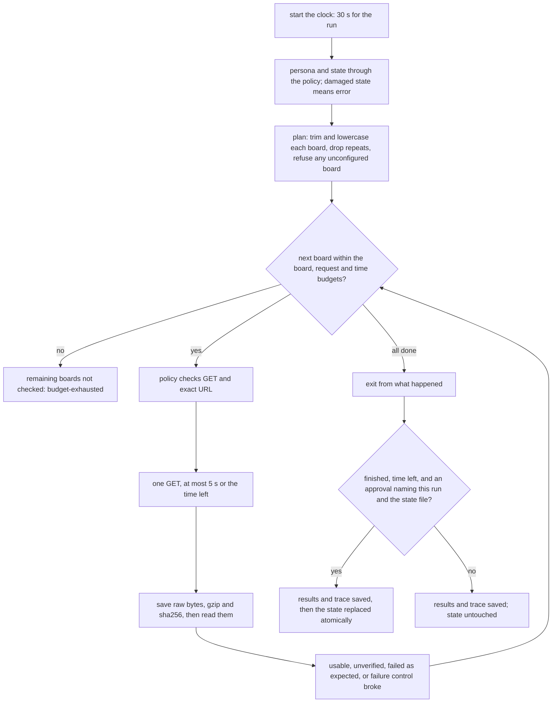

# Job-Search Agent 2 — The Loop, the Tools, and the Diff

INFO 7375 · Fall 2026 · Suketh Produtoor (`suketh-p`) · branch `js2-loop-tools-diff`

`jobwatch` is a bounded loop over **three public job boards on two applicant-tracking systems**: Anthropic and Databricks on Greenhouse, Linear on Ashby. A failure run adds a **failure control**, a Greenhouse board name that does not exist and should answer 404.

Each run stays inside written budgets. It saves every raw response before reading it, keeps per-board history, screens new postings with JS1's literal rule for a fictional persona, and ends with one of four exits: `finished`, `incomplete`, `budget-exhausted`, `error`. Every request and every file operation passes a **permission policy enforced in code**. Replacing the saved state needs an approval the student gives on the command line. **No model is called.**

- **The specification is the student's [GATE.md](GATE.md)**, committed before any code (`b55d2a5`).
- **Started from** the student's JS1 work: 12 files copied unchanged from `js1-contract-and-watch` at `99a7443` (`d133453`). The board endpoints come from the instructor's collector, Lectern (`ATS.md`), checked by Claude Code's own probe on 2026-11-08.

Claude Code drafted this README from the commit record. The student's words are quoted, and [SOURCES.md](SOURCES.md) says who wrote what.

## Language, toolchain, and what a TA needs

| | |
|---|---|
| Language | Python 3, standard library only (no `pip install`). Ran on Python 3.12.7 (Anaconda), macOS 27.0.1 |
| Tests | `unittest`, **164 tests**, offline. Four real-socket tests use 127.0.0.1 and take about 4 s. Claude Code wrote 160; the student wrote `tests/test_review_empty_board.py` (4) |
| Network | HTTPS GET only, to the four endpoints in [jobwatch/boards.py](jobwatch/boards.py) (`python3 -m jobwatch boards` lists them); redirects never followed |
| Model | None. The agent makes no model calls (GATE.md). Claude Code (Claude Opus 5.5) built it |
| Persona | Fictional: Alex Morgan, [persona/alex_morgan.json](persona/alex_morgan.json), from JS1 |

Run every command from this folder (`fall-2026/suketh-p/js2-loop-tools-diff/`).

**1. The tests** (offline, about 5 s):

```bash
python3 -m unittest -v
```

**2. Check that the saved raw bodies of the trace run are byte-for-byte what the boards sent** (the sha256 recorded at retrieval):

```bash
python3 -m jobwatch verify runs/2026-11-08-failure-2
```

**3. The independent check on that run.** It does not import the agent. It recounts jobs and keys from the saved bodies and compares the state copies taken before and after:

```bash
python3 -I checks/independent_check.py runs/2026-11-08-failure-2 --state-before evidence/state-before-2026-11-08-failure-2.json --state-after evidence/state-after-2026-11-08-failure-2.json
```

**4. The permission policy's boundary cases**, run through the real policy beside the student's predictions:

```bash
python3 policy/boundary_table.py
```

**5. The finished-wrong-answer demonstration** (SEEDED, offline). It writes `demos/finished-wrong-answer/<label>/`:

```bash
python3 demos/finished_wrong_answer.py --label my-rerun
```

**6. A live failure run of your own.** It adds the deliberate 404 board, ends `incomplete`, and never touches `state/`:

```bash
python3 -m jobwatch run --run-id ta-failure-1 --failure-control
```

**7. A live normal run with your own approval.** This replaces `state/state.json` in your clone; the committed one is this project's evidence:

```bash
python3 -m jobwatch run --run-id ta-normal-1 --approve-state ta-normal-1:state/state.json
```

Exit codes: 0 `finished`, 1 `error`, 3 `incomplete`, 4 `budget-exhausted`; 2 is a usage error.

## What ran

Times are EST; "Code" is the commit the run used.

| When | Run | Mode | Run by | Result | Evidence | Code |
|---|---|---|---|---|---|---|
| 11-08 05:45 | `2026-11-08-failure-1` | live | Claude Code | **incomplete**: anthropic 675, databricks 922, linear 32 usable (provisional baselines, since no state existed); the failure control answered 404 as expected and its count is unknown. No state written. Check PASS | [run](runs/2026-11-08-failure-1/results.md), [terminal](evidence/terminal/2026-11-08-failure-1.txt) | `5d8bc8c` |
| 11-08 05:47 | finished-wrong-answer, before the fix | **SEEDED** | Claude Code | With Linear emptied, the run ended **finished**, reporting Linear "usable, 0 jobs". Check **FAIL**: it caught the wrong finish | [summary](demos/finished-wrong-answer/at-8020acb-before-fix/SUMMARY.md) | `8020acb` |
| 11-08 06:17 | `2026-11-08-normal-1` | live | **the student**, with their own approval | **finished**: baselines of 675, 922 and 32 postings; `state/state.json` created. Check PASS | [run](runs/2026-11-08-normal-1/results.md), [terminal](evidence/terminal/2026-11-08-normal-1-run-by-student.txt) | `ecd83b7` |
| 11-08 06:19 | `2026-11-08-failure-2`, **the trace** | live | **the student** | **incomplete**: 0 new on each board; 404 as expected. The student's `cmp`: state unchanged. Check PASS | [trace](runs/2026-11-08-failure-2/trace.md), [terminal](evidence/terminal/2026-11-08-failure-2-run-by-student.txt) | `0507a83` |
| 11-09 00:41 | finished-wrong-answer, after the fix | **SEEDED** | Claude Code | The same empty Linear body now ends **incomplete**, with Linear `unverified`. Check PASS | [summary](demos/finished-wrong-answer/at-4e39762-after-fix/SUMMARY.md) | `4e39762` |

Test runs, RED and GREEN, are in [evidence/test-runs/](evidence/test-runs/), in order. No live run so far has found a new posting: all were within three hours of the baseline.

## How one run works



Every run that has a folder writes `results.json`, `results.md`, `trace.json` and `trace.md`, whatever its exit. When two exits apply, the earlier one wins: error, then budget-exhausted, then incomplete.

## GATE.md → code → test

| GATE.md says | Code | A test that fails if it breaks |
|---|---|---|
| Four exits, each with its report; only `finished` advances the state | `loop.run`, `loop.may_advance_state` | `test_loop.ExitTest` (14 cases); wrong version 2 |
| At most 4 boards, 4 requests, 30 s; each request at most 5 s or the time left; the clock covers fetching, processing and saving | `loop.Budget`, `budget_stop`, `request_deadline`; `net.https_get` | `test_loop.BudgetTest`, `test_net`, `test_net_socket` (real sockets); wrong version 3 |
| The same ATS and slug, trimmed and lowercased, is fetched once; a failed request still uses its one attempt | `loop.unique_boards` | `test_loop.RepeatRuleTest`; wrong version 3 |
| History by ATS, slug and key (Greenhouse `id`, Ashby `jobUrl`, never opened); a board's first usable snapshot is its baseline; a title change or a returning posting is not new | `state.py`, `ats.py` | `test_state`, `test_loop.HistoryTest`, `test_ats`; wrong version 4 |
| Save raw before interpreting; a failed, non-200, malformed or **empty** board is unverified and the run continues; zero retries; a failure control that does not 404 is an error; a policy denial, corrupt state or failed required write stops the run | `loop.run`, `loop.classify_response` | `test_loop.ExitTest`, `TraceTest`; **the student's `tests/test_review_empty_board.py`** (empty boards) |
| The permission policy | `policy.py`, `files.py` | `test_policy`, [policy/BOUNDARY-RESULTS.md](policy/BOUNDARY-RESULTS.md); wrong versions 5–6 |
| No model calls | no model code in `jobwatch/` (JS1's judge and transports were not carried) | a search of `jobwatch/` on 2026-11-09 ([POLICY.md](POLICY.md)) |
| The six wrong versions | [tests/wrong_versions.py](tests/wrong_versions.py) | [tests/test_wrong_versions_caught.py](tests/test_wrong_versions_caught.py) swaps each in. Wrong version 1's empty-list half is caught by the student's test instead |

The tests were committed and seen failing before the agent code existed (`7db4ab4`, then GREEN `208d1e3`).

## The deliberate failure, and a finished wrong answer

- **The deliberate failure** is the failure control, `jobwatch-no-such-board-js2`. In both live failure runs it answered 404. The loop recorded the raw 38-byte body, reported the count as unknown rather than 0, checked the other boards, and ended `incomplete`. In the student's run against saved history, the state file came out byte-identical ([trace](runs/2026-11-08-failure-2/trace.md)).
- **A finished wrong answer** (SEEDED). Before the review-packet patch, an empty Linear response ended `finished` and was reported as "usable, 0 jobs, no new postings". The run saved the empty snapshot as checked. The agent's own report gave no sign of it. The **independent check**, which reads the saved body and the two state copies and does not import the agent, flagged it: *"ashby/linear: reported usable, but its saved response has 0 jobs"*. After the patch, the same input ends `incomplete` and the check passes. Its criterion is the student's (GATE.md, wrong version 1): "check the saved body and before-and-after state separately from the loop's report."

## The permission policy, and the review packet

- **[POLICY.md](POLICY.md):** the policy as written, as enforced (checks in order), and as tested. **All 21 of the student's predictions match** ([BOUNDARY-RESULTS.md](policy/BOUNDARY-RESULTS.md)). The page also covers what testing showed that the predictions did not, and Chapter 5's limits applied here.
- **[review-packet/README.md](review-packet/README.md):** the empty-board change, reproduced first, with the student's test written and seen failing before the patch, Claude Code's plan, the student's request, the 2-line diff, the audit record, the student's own checks, and the decision (**accept**). It also says what the record does not show: that the audit preceded the checks.

## Calls Claude Code made where GATE.md was silent

These were not put to the student one by one. The two exits the student did decide are in [SOURCES.md](SOURCES.md).

- **Exit precedence** when two exits apply: error, then budget-exhausted, then incomplete.
- **A failure control that does not answer 404** ends the run `error`, but only after the other boards are checked: the error policy lists only a policy denial, corrupt state or a failed write as reasons to stop.
- **The approval format**: `--approve-state RUN_ID:state/state.json`, with the run id chosen beforehand (`--run-id`). An otherwise complete run without it ends `incomplete`.
- **The board list lives in code**, because the read policy allows only the persona, the state and run evidence.
- **Ashby for JS1's rule**: `title` → title, `location` (a string) → `location.name`, `descriptionHtml` → content. `secondaryLocations` are ignored.
- **Storage**: keys are stored as strings. The state schema is new (`jobwatch-state/2`). JS1's state is not imported, and a JS1 state file is refused as damaged rather than used. Raw bodies are stored gzip-compressed, with the sha256 of the uncompressed bytes (JS1's practice, checked by `verify`).
- **Order of writes**: results and trace are written even after the time budget runs out. Only the state update is blocked. They are written before the state, so a crash between the two would leave a report saying `finished` beside the old state. The independent check would flag that; it was not tested.
- **Run ids** are letters, digits, `.`, `_` and `-`, at most 64 characters. A run never reuses an existing folder.

## Known limits

- **A partly emptied board counts as usable** (the student's "one case my test would still miss"): one posting from a board that usually has hundreds.
- **The rule is literal** (JS1). Linear lists locations like "North America" and "Europe", which never match the persona's location terms, so no Linear posting can be relevant.
- **New postings on live data are not shown yet**: every live run found 0 new.
- **The approval is a string** on the command line; nothing proves who typed it. Time-of-check versus time-of-use is not defended or tested ([POLICY.md](POLICY.md)).
- **Ashby's `isListed: false` postings** were not examined; all 32 were listed on 2026-11-08. Greenhouse's and Ashby's terms of use were not reviewed in detail beyond their public API documentation. Only macOS and Python 3.12.7 were tried.

## Driver's seat

Drafted by Claude Code from the record, for the student to correct.

| Part | Claude Code did | The student did | Why it stays the student's | Where it shows |
|---|---|---|---|---|
| **The loop's gate**: exits, budgets, repeat rule, error and permission policy, wrong versions | Probed the boards; gave a worksheet of the brief's questions; laid out two readings of the gate twice | Wrote GATE.md before any code; chose `incomplete` for a wrong approval and "unverified, keep going" for a redirect | The exits decide what "done" means for this search, and the policy decides what the agent may touch | `b55d2a5`; the message of `7db4ab4` |
| **The loop's boundaries** | Listed 21 cases from the gate, added 14, ran them all | Predicted all 21 before any policy code | A prediction written afterward only describes the output | `f871ccb`; [BOUNDARY-RESULTS.md](policy/BOUNDARY-RESULTS.md) |
| **The loop's code and tests** | Wrote the agent and 160 of 164 tests; found and fixed three of its own defects test-first | — | — | `7db4ab4` → `208d1e3`; `431ac57`, `c17621e` |
| **Running the loop for real** | Ran the first failure run | Ran the first finished run with their own approval; ran the failure run against saved history and compared the state themselves | Approving a state write is theirs, and so is checking their own claim | `0507a83`, `72195da` |
| **The finished wrong answer** | Wrote the seeded demonstration and the independent check | Named the check's criterion in GATE.md | The check must fail differently from the agent; the criterion is the student's standard | GATE.md wrong version 1; `ecd83b7` |
| **The review** | Proposed the candidate change and the all-empty case; wrote the plan and the patch; ran the full suite after the decision | Chose the change; wrote the review gate, the test (before the patch), the request, the audit and the decision | The requirement, the test and the decision are where understanding goes on record | [review-packet/README.md](review-packet/README.md) |
| **The sign-off** | Listed the facts below | Writes it, and signs or withholds | Their name goes on it | below |

## Sign-off

**Pending: the student writes it.** Chapters 4–6 ask that it be written from the record, not from a fluent draft. The facts Claude Code can state for it:

- **The student's own tests and checks:**
  - `tests/test_review_empty_board.py`, 4 cases, written before the patch, RED in the student's run (v1) and in Claude Code's (v2), passing in the student's run on `4e39762`.
  - The run `2026-11-08-failure-2`, with the student's `cmp` (state unchanged) and the independent check (PASS).
  - The 21 predictions, all matching.
- **Claude Code's tests and checks:** the other 160 tests; the wrong versions swapped in; `verify`; the independent check on the other runs; the full suite on the patch, run after the decision.
- **Not checked:**
  - That the audit preceded the checks: saved 18 s after the test command started.
  - A partly emptied board.
  - Who typed an approval.
  - Time of check versus time of use.
  - The student's own full-suite run on the patch.
  - New postings on live data.
  - Terms of use in detail; other systems and Python versions.
- **Not claiming:**
  - That an empty or small board means a company isn't hiring.
  - That a "relevant" posting suits anyone.
  - That `finished` means the results are right.
  - That the policy is a sandbox.
  - That any test approval was a person's.
  - That the independent check shows completeness rather than consistency with the saved bodies.

```text
Sign-off — Job-Search Agent 2
Checked:      which properties, by which of my own tests (name them)
How:          by hand / by a test I wrote before reading Claude's code /
              by recomputation / with Claude's help (say which parts)
Not checked:  at least three real items
Not claiming: what this agent does not show
Signed or withheld: ____________ (name, date)
```
