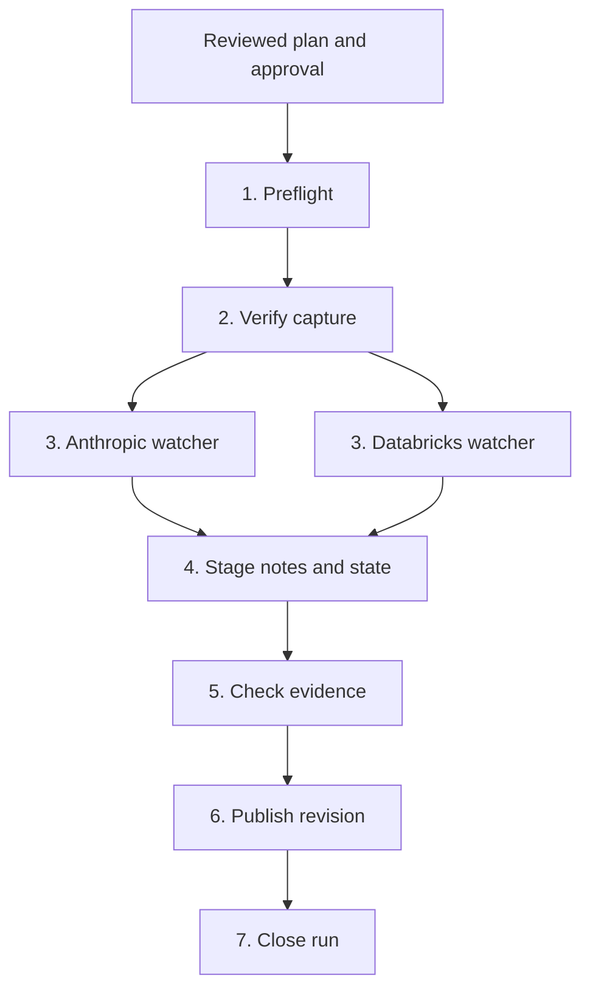

# PLAN.md · Job-Search Agent 4

**Plan owner** Suketh Reddy Produtoor  
**Date** 2026-11-25  
**Version** 0.1 · Draft for review  
**First reviewer** A classmate from INFO 7375  
**Reviewed by** Pending

## Objective

I’m starting from JS3 commit `ae850602` and the collection rules in my JS2 `GATE.md`. The current loop saves responses before parsing, fetches each board once, and advances state only after a finished run with approval. JS3 screens saved responses separately. The current `jobwatch-state/2` file remembers which keys appeared and when it first saved them. It has no revision counter or current liveness field.

| Candidate objective | What would count as success |
|---|---|
| **A. Evidence I can audit** | Every consequential claim has a dated source and passes a separate check, or the report says what remains unknown. A planted false count and a stale write both get caught before publication. |
| **B. Find more relevant roles** | The shortlist surfaces all ten qualifying roles in a fixed, independently labeled test set. |
| **C. Finish faster** | The same saved-input run produces its report in ten seconds or less. |

A report could verify every disclosed claim and surface only nine of ten qualifying roles. That passes A and misses B. A checked run could take 18 seconds and pass A while missing C. A run could surface all ten qualifying roles in 18 seconds and pass B while missing C.

I’d choose **A**. I want to open the report and see which source supports a claim, when the source observed it, and why the agent stopped if the evidence fell short. This leaves the applicant’s interest in seeing every plausible match outside my success criterion for this version.

## The steps

I’ll use Python 3.12, the standard library, and `unittest`. The planned demonstration replays the **November 8 JS2 capture** and the **November 24 JS3 capture** in capture order. Both replays will be labeled **SEEDED** and retain the original capture timestamps. I’ll use a separate replay workspace with its own state file.

| Step | Inputs | Output and permission |
|---|---|---|
| **1. Preflight** | Reviewed plan, dated approval, unique run ID, board list, saved capture, and prior state | Record the run mode, approved paths, starting revision, and state hash. Check paths and verify that the run folder is new. Read the fictional persona, approved state, and named saved captures. |
| **2. Verify the capture** | Saved trace and raw bodies | Recompute the raw SHA-256 hashes and independently recount unique posting keys. Record each board’s capture time and usable or unknown status. Write results inside the current run folder. |
| **3. Run both watchers** | The verified capture and the same starting state | The Anthropic and Databricks watchers each produce source-linked notes for their own board. Both use the same JS3 scoring rules. Linear remains part of the corpus and seen-key comparison. |
| **4. Stage notes and state** | Both watcher outputs, the confirmed capture, and the prior state | Write both workers’ contributions to one `notes.json` in the current run folder through a shared writer. Stage the state update, the two-day diff, and the summary. The staged state records the revision it was based on. |
| **5. Check the evidence** | Staged outputs, saved raw responses, and prior state | Run the checks below and record a result for each. Run the planted-count, stale-write, and closure cases on disposable fixtures. Keep the fixture results visibly labeled. |
| **6. Publish the revision** | Passing checks, staged state, and approval for the exact run ID, target file, and starting revision | Under the shared writer’s lock, reread the target and compare its revision and hash with the preflight values. On a match, atomically replace the state file and advance the revision once. |
| **7. Close the run** | Check results, commit outcome, and budget usage | Report the exit status, evidence paths, unresolved claims, and whether state advanced. |

The watchers run in the **same run** and can prepare notes in either order. The shared writer records Anthropic before Databricks and deduplicates by board and posting key. Their board inputs differ, and they share parsing and scoring code. I’ll use a separate checker for verification.

The proposed state revision covers the seen keys and their source references as one record. I’ll retain first-seen history and record later observations with the board, posting key, run ID, capture time, and source hash. A returning key keeps its original first-seen record. The replay updates only the approved copy of `state/state.json`.

## Dependencies

This order is executable once I have the reviewed plan, approval, and replay workspace. The saved November 8 and November 24 responses already exist. The November 8 replay produces the prior state the November 24 replay needs. Each watcher can finish from its own board’s verified input. A stop at any step goes directly to closeout.

If I later authorize a live capture, I’ll use the existing collector with its compatible JS2 state format and omit state-write approval. An `incomplete` collector exit caused solely by missing state approval can still supply evidence if all three board responses pass verification. The JS4 writer will handle its own revisioned state after those checks.

## Evidence on the edges

| Handoff | Condition the next step checks |
|---|---|
| Approval → Preflight | The dated approval names the plan version, run, allowed inputs, and state target. The reviewer’s comments and my disposition are recorded. |
| Preflight → Capture verification | The run ID is unused. The approved capture paths resolve inside the replay workspace. The starting state revision and hash are recorded. |
| Capture verification → Each watcher | The worker’s board has a usable response, a matching raw hash, a capture timestamp, and a unique-key count that agrees with the independent recount. |
| Each watcher → Staging | The worker’s rows identify its own board. Every row resolves to a posting key in that board’s verified capture. |
| Staging → Evidence checks | Both contributions appear in the shared notes file. The summary and state proposal identify the capture and starting revision they used. |
| Evidence checks → Publication | The checker agrees with the staged claims or records an abstention. The planted mismatch fails as expected, and the stale-write fixture preserves the accepted revision. |
| Publication → Closeout | The saved state records the approved run and incremented revision, or the stop record gives the reason and the unchanged revision. |

| Claim | Check and failure it catches |
|---|---|
| **Board count** | Recount keys directly from the raw response with a checker that does not import the summary generator. Compare with the trace and summary. Plant **42 in the trace and 99 in the summary** and require rejection. |
| **New** | Independently subtract the prior seen-key set from the current verified set. A first capture is a baseline, and a returning key keeps its first-seen history. |
| **Still listed or gone** | Check the exact key against the dated board response. Membership supports “listed as of capture.” Absence supports “missing from this list,” with liveness unresolved. For the seeded closure case, require an explicit closure record for the same key. |
| **Location or remote** | Compare the location field with the role’s own travel, hybrid, or office-attendance terms. If the two leave the work arrangement unclear, say so. |
| **Work authorization or sponsorship** | Read the passage in context and check whether it applies to this role. Company-wide visa language leaves role-specific sponsorship and authorization unresolved. |
| **Pay** | Verify the original range, currency, period, and whether it describes base pay or total compensation. Keep any location or level qualifiers. |

I’ll run the raw-count check, the independent new-key comparison, and the planted summary check. To test liveness, I’ll use a seeded case where memory still lists a key as live and a later source explicitly closes it. The November 24 comparison gives a separate real example of **271 remembered keys missing from a later list**, with closure unresolved.

## Stop conditions and refusal paths

| Exit | Condition |
|---|---|
| **`finished` (0)** | All required boards and checks pass, both watchers’ notes are present, and the approved revision commits. |
| **`incomplete` (3)** | Some board evidence is usable and a required board or approval is missing. Report what is available as provisional and preserve state. |
| **`budget-exhausted` (4)** | A board, request, or time limit blocks required work. Report the limit, usage, and unfinished steps. |
| **`error` (1)** | A policy check rejects an operation, state is corrupt or stale, evidence conflicts, no normal board is usable, or a required write fails. Halt before advancing state. |

For the stale-write test, both proposals will start from the same revision. After the first commits, the second must receive a conflict. I’ll compare the bytes before and after the refusal to check that the first update survives. For the shared-notes test, instruction-like posting text must remain a literal string, with no corresponding action in the trace.

The code owns the stop. The check records the failed condition, the expected and observed values, and the source involved. I decide whether to reconcile the evidence, change the plan, or stop. A failed run keeps its records. Resumption requires a corrected input or a reconciled revision under a new run ID.

## Budgets

- Keep the JS2 ceilings of **four configured boards, four HTTP requests, and 30 seconds per run**. A request gets at most **five seconds** or the remaining time, whichever is shorter. Duplicate board entries get one fetch and failed requests get zero automatic retries.
- The seeded runs use **zero HTTP requests and zero model calls**. A later live capture requires separate dated approval and stays on the existing HTTPS GET allow-list. The deliberate 404 board counts toward both caps if I authorize it for a separate control run.
- I’ll review at most **eight postings per run**, prioritizing conflicting evidence and unresolved claims I would rely on. I’ll review them outside the automated run’s clock.
- I can change these limits in a dated plan revision before the next run.

## The review

I’ll ask a classmate to review the first version, focusing on the state handoff and whether the evidence supports each claim. After the review, I’ll record the criticism, what I checked myself, and what I changed.

## Counterexample from review

## Approval

**Pending.** I’ll record my approval and date after the review. Any state write also needs approval for the specific run, target file, and expected revision.

## Changes after the run started
