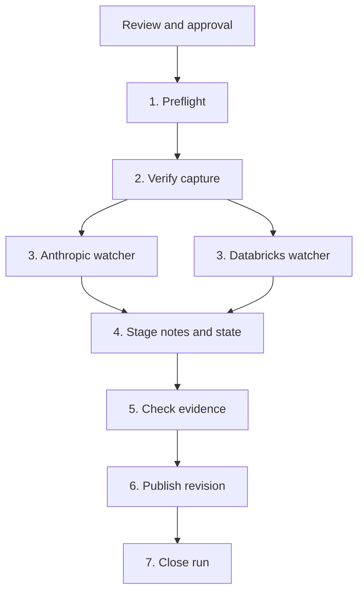

# PLAN.md · Job-Search Agent 4

**Plan owner** Suketh Reddy Produtoor  
**Date** 2026-11-25  
**Version** 0.2 · Reviewed draft  
**First reviewer** Claude, 2026-11-25  
**Reviewed version** v0.1, commit `d349bacb`

## The review

Claude’s comments, verbatim:

```text
# Review of PLAN.md v0.1 (2026-11-25)

1. **Step 3→4: the writer handoff is not executable.** The plan says the watchers "can prepare notes in either order" and also that the shared writer records Anthropic before Databricks. It never says who owns the writer or whether the two watchers run concurrently. *Scenario:* both watchers finish at the same moment and each writes `notes.json`. One contribution overwrites the other, and the "both contributions present" check at Step 4→5 has no defined behavior to test. *Change:* add a Step 4 rule that each watcher writes its own file (`notes.anthropic.json`, `notes.databricks.json`). The writer then merges them in fixed order and rejects a missing or duplicated board.

2. **Step 2 and Step 5: the evidence is not independent.** The "separate checker" is described only by "does not import the summary generator". The plan also says the watchers "share parsing and scoring code". *Scenario:* a parser bug miscounts a key in the shared module. The checker reuses the same parser, so the recount agrees with the wrong number and the planted 42/99 case still passes. *Change:* require the checker to parse the raw bytes with its own code, with no imports from the watcher or parser modules. Add one hand-counted fixture whose expected count is written in the plan.

3. **Step 6: the approval and stale-write semantics have gaps.** Approval names the run, file, and starting revision, but the plan never says what happens if the revision or hash changes after approval and before the lock. The Step 6 reread also depends on the file having a revision field, and `jobwatch-state/2` has none. *Scenario:* approval is given at revision 3, another writer commits revision 4, and the reread finds a mismatch. The plan does not say whether the approval is void or can be reused. A JS2 state file has no revision at all, so the compare cannot run. *Change:* state that any mismatch voids the approval and requires fresh approval under a new run ID. Define the migration that creates revision 0 and its hash, and test it.

**Assumption, not a finding:** the "271 remembered keys" figure should be reproduced before it is cited.
```

I checked the comments against v0.1, the JS3 source at `ae850602`, and the saved board responses.

| Review item | Verification and v0.2 decision |
|---|---|
| **Writer handoff** | v0.1 already called for a shared writer. It left writer ownership and the per-worker handoff implicit. v0.2 gives each watcher its own output path and assigns the final merge to one writer. |
| **Independent count** | JS3’s `checks/independent_check.py` already parses the saved JSON itself and imports only the standard library. v0.2 makes that separation a requirement and adds a fixture with 42 unique keys as an independently specified expected count. |
| **Approval and revision** | v0.1 already required a match under the lock before writing. The inherited state schema has no revision field, and the inherited approval contains only a run ID and path. v0.2 defines revision 0 and explicitly voids approval on a revision or hash mismatch. |
| **271 remembered keys** | A read-only recount confirmed 137 Anthropic, 131 Databricks, and 3 Linear keys absent from the November 24 lists. The earlier seen history remains evidence of prior observation. Closure remains unresolved. |

## Objective

I’m starting from JS3 commit `ae850602` and my JS2 `GATE.md`. The existing loop saves raw responses before parsing, fetches each board once per run, and updates state only on a finished, approved run.

| Candidate objective | Success criterion |
|---|---|
| **A. Evidence I can audit** | Every consequential claim passes a dated source check or states what remains unknown. The planted false count and stale write both fail before publication. |
| **B. Find more relevant roles** | Surface all ten qualifying postings in a fixed, independently labeled fixture. |
| **C. Finish faster** | Complete the same saved-input run in ten seconds or less. |

A report could verify every claim and surface only nine of ten matches. That passes A and misses B. A checked run could take 18 seconds and pass A while missing C. A run could surface all ten matches in 18 seconds and pass B while missing C.

I’d choose **A**. I want to know what the source actually supports before I rely on a posting or advance memory. Finding every plausible match remains a separate goal.

## The steps

I’ll use Python 3.12, the standard library, and `unittest`. I’ll replay the saved **November 8 JS2** and **November 24 JS3** responses in capture order. Both runs will be labeled **SEEDED** and carry the original capture timestamps.

| Step | Inputs | Output and permission |
|---|---|---|
| **1. Preflight** | Reviewed plan, dated approvals, unused run ID, named captures, and starting-state receipt | Validate paths and record the target, revision, and SHA-256. Read only approved inputs. Write run evidence under the current run folder. |
| **2. Verify the capture** | Saved trace and raw responses | Recompute the raw hashes and independently recount unique posting keys. Record each board’s capture time and usable or unknown status. |
| **3. Run both watchers** | Their own verified board response and the same starting state | The Anthropic watcher writes `notes.anthropic.json`. The Databricks watcher writes `notes.databricks.json`. Both use the same pinned JS3 scoring rules. Linear remains part of the corpus and the seen-key comparison. |
| **4. Stage notes and state** | Both worker files, the verified capture, and prior state | The coordinator validates board ownership, posting keys, and source references. It requires exactly one contribution per watcher and alone writes `notes.json`, in Anthropic-then-Databricks order. Stage the summary, two-day diff, and state candidate. |
| **5. Check evidence** | Staged outputs, raw responses, and starting state | Record the independent checks. Run the count mismatch, stale-write, and closure cases against labeled disposable fixtures. Keep instruction-like posting text as literal data. |
| **6. Publish the revision** | Passing checks, staged state, and run-specific approval | Acquire the target’s write lock. Reread the target and compare its revision and hash with the approval. On a match, atomically write the candidate and advance the revision once. |
| **7. Close the run** | Check results, write outcome, and budget usage | Report the exit, evidence paths, unresolved claims, and whether state advanced. |

The replay workspace starts with an empty `jobwatch-state/3` at revision 0. The November 8 replay establishes the baseline. The November 24 replay reads that committed revision. In a separate migration fixture, I’ll copy a valid `jobwatch-state/2` record into revision 0, preserve its seen keys and run history, and record the original file hash. The legacy records establish previous sightings. Liveness starts unknown.

The two watchers can finish in either order. Their board inputs differ, and they share parsing and scoring code. The independent checker supplies the second route for verification.

## Dependencies



The captures already exist. Before either run, a read-only state receipt supplies the revision and hash the approval needs. The first run must commit before the second can receive its own approval. Within a run, neither watcher depends on the other. A stop at any step goes directly to closeout.

## Evidence on the edges

| Handoff | What the next step checks |
|---|---|
| Review → Preflight | Record the dated review and the owner’s approval for the plan version, run, inputs, and state target. |
| Preflight → Capture | The run ID is unused, the input paths resolve inside the approved workspace, and the starting revision and hash match the receipt. |
| Capture → Each watcher | Its board response has a matching hash, usable status, capture timestamp, and independently verified unique-key count. |
| Each watcher → Staging | Exactly one file comes from each expected board. Every note’s key resolves to that board’s verified capture. |
| Staging → Checks | Both contributions appear in `notes.json`. The summary and proposal name the same capture and base revision. |
| Checks → Publication | Source checks pass or the report records an abstention. The planted count fails, and the stale-write fixture preserves the accepted state bytes. |
| Publication → Closeout | The state records the approved run and incremented revision, or the stop record gives the reason and before-and-after revision. |

The count checker will decode the saved raw responses with standard-library code independent of the watchers, ATS parser, and summary generator. The count fixture will contain exactly **42 unique keys**, numbered 1 through 42. I’ll first check that the recount returns 42. I’ll then put 99 in the summary and require rejection before publication.

| Claim | Evidence check |
|---|---|
| **Board count** | Compare the independently counted raw keys with the trace and displayed summary. |
| **New** | Subtract the prior seen-key set from the verified current set. A first capture establishes a baseline. A returning key keeps its first-seen history. |
| **Still listed or gone** | Check the exact key in the dated capture. Membership supports “listed as of capture.” Absence leaves liveness unresolved. An explicit closure record for the same key supports closure in the seeded fixture. |
| **Location or remote** | Check the location field and any role-specific travel, hybrid, or office requirements. |
| **Authorization or sponsorship** | Check the original passage for role-specific wording. General visa assistance leaves the role-specific question open. |
| **Pay** | Confirm the amount, currency, period, compensation type, and any location or level qualifiers against the posting. |

Each remembered observation will carry the board, posting key, capture time, run ID, and source hash.

## Stop conditions and refusal paths

| Exit | Condition |
|---|---|
| **`finished` (0)** | Required boards and checks pass, both watcher contributions are present, and the approved revision commits. |
| **`incomplete` (3)** | Some board evidence is usable and a required board or approval is missing. Report provisional results and preserve state. |
| **`budget-exhausted` (4)** | A board, request, or time limit blocks required work. Report usage and the unfinished step. |
| **`error` (1)** | Policy denies an operation, state is malformed or stale, evidence conflicts, no normal board is usable, or a required write fails. |

A revision or hash mismatch **voids that run’s approval**. The writer reports the expected and observed values and preserves the current state. To resume, I’ll reread the latest record, reconcile the proposal, and authorize a new run ID against the new receipt. The same proposal gets zero automatic retries.

## Budgets

- Keep the JS2 ceilings of **four configured boards, four HTTP requests, and 30 seconds per run**. Each request gets at most **five seconds** or the remaining time. Each board gets one attempt.
- Seeded runs use **zero HTTP requests and zero model calls**. A later live capture requires separate dated approval and uses the existing HTTPS GET allow-list. The deliberate 404 control counts toward both caps.
- I’ll review up to **eight postings per run**, outside the automated clock, starting with conflicting evidence and unresolved claims I would rely on. I can change the budgets in a dated plan revision before a run.

## Counterexample from review

Both watchers finish together. If both can publish to `notes.json`, one contribution can overwrite the other. In v0.2 each watcher has its own output path and the coordinator owns the shared file. I’ll test that a missing contribution or two files claiming the same board stops the merge before publication.

## Approval

I approve PLAN.md v0.2 (ac451bf5) for the JS4 build and the two planned offline replays. Start by copying JS3 at ae850602 unchanged in its own commit. Each state write requires my separate approval for the run ID, target path, starting revision, and SHA-256. Any live collection requires separate dated approval. Suketh Reddy Produtoor · 2026-11-25

## Changes after the run started
